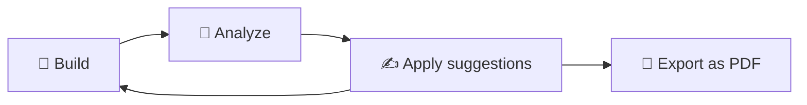
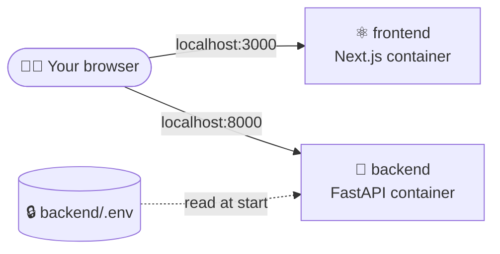

<div align="center">


<a href="#-features">
  
</a>

**An AI-powered resume builder and analyzer designed to help job seekers create ATS-friendly, recruiter-ready resumes with a beautiful editing experience.**

[](https://nextjs.org/)
[](https://fastapi.tiangolo.com/)


[](#-docker)

<br />

[✨ Overview](#-overview) •
[🚀 Features](#-features) •
[🛠️ Tech Stack](#️-tech-stack) •
[🏁 Getting Started](#-getting-started) •
[🐳 Docker](#-docker) •
[🧪 Testing](#-testing) •
[📈 Roadmap](#-roadmap)

</div>

<br />

## ✨ Overview

> [!TIP]
> ResumeForge is an end-to-end resume platform that combines an intuitive visual resume builder with a powerful AI-assisted analyzer.

<table>
  <tr>
    <td align="center" width="33%">🎓<br /><b>Student</b><br /><sub>applying for internships</sub></td>
    <td align="center" width="33%">💻<br /><b>Software engineer</b><br /><sub>targeting FAANG</sub></td>
    <td align="center" width="33%">🧑‍💼<br /><b>Experienced professional</b></td>
  </tr>
</table>

Whether you're a student applying for internships, a software engineer targeting FAANG, or an experienced professional, ResumeForge helps you create polished, ATS-friendly resumes while providing actionable feedback to improve your chances of landing interviews.



<br />

## 🚀 Features

<table>
  <tr>
    <td valign="top" width="50%">

### 📝 Visual Resume Builder

- Live resume preview
- Multiple professional templates
- Real-time editing
- ATS-friendly layouts
- Automatic pagination
- Export as PDF
- Import an existing resume (PDF or DOCX) — parsed deterministically, then reviewed by AI before it fills the builder
- Reorder entries within every section

</td>
    <td valign="top" width="50%">

### 🤖 Resume Analyzer

- ATS compatibility score
- AI-powered resume feedback
- Resume section analysis
- Keyword optimization
- Grammar & writing suggestions
- Actionable improvement tips
- Analyze directly from the builder and apply rewritten bullets in one click

</td>
  </tr>
  <tr>
    <td valign="top" width="50%">

### 🏢 ResumeForge for Businesses

- Screen a batch of resumes against one job description (`/business/screening`)
- Parallel queues — one per opening, all screening at once with fair scheduling
- AI extracts requirements once; recruiters review and edit them
- Deterministic, explainable 100-point match score for every candidate
- On-demand AI candidate briefs with gaps and interview questions
- PDF, Excel and CSV export; nothing stored server-side
- AI features run on your own key (BYOK); scoring is free

</td>
    <td valign="top" width="50%">

### 🔑 Bring Your Own Key

- Add an OpenAI, Anthropic, Google Gemini, Groq or OpenRouter key in the app
- Individuals: ResumeForge's free AI runs first; your key is used only when it's exhausted
- Businesses: AI features always use your key
- Key stays in your browser (opt-in "remember on this device"); the server forwards it per request and never stores or logs it

</td>
  </tr>
  <tr>
    <td valign="top" width="50%">

### 🎨 Modern UI

- Responsive design
- Smooth animations
- Clean dashboard
- Professional typography
- Light & Dark mode support
- Fast editing experience

</td>
    <td valign="top" width="50%">

### ⚡ Performance

- Fast PDF generation
- Optimized rendering
- Lightweight frontend
- Efficient backend APIs

</td>
  </tr>
</table>

<br />

## 🛠️ Tech Stack

<div align="center">

<table>
  <tr>
    <th>Frontend</th>
    <th>Backend</th>
    <th>Tooling</th>
  </tr>
  <tr>
    <td align="center"></td>
    <td align="center"></td>
    <td align="center"></td>
  </tr>
  <tr>
    <td valign="top">

- Next.js 16
- React 19
- TypeScript
- Tailwind CSS
- Framer Motion
- React PDF

</td>
    <td valign="top">

- FastAPI
- Python
- Groq (free tier), with OpenRouter free models as fallback
- Pydantic

</td>
    <td valign="top">

- Docker & Docker Compose
- pytest

</td>
  </tr>
</table>

**🧠 AI:** Resume Analysis · ATS Scoring · Resume Feedback · AI Suggestions

</div>

<br />

## 🏁 Getting Started

**1️⃣ Clone**

```bash
git clone https://github.com/Anirudh-Kambampati/ResumeForge-Resume-Analyzer.git
```

```bash
cd ResumeForge-Resume-Analyzer
```

<details>
<summary><b>2️⃣ Frontend</b> ⚛️</summary>

<br />

```bash
cd frontend
npm install
npm run dev
```

</details>

<details>
<summary><b>3️⃣ Backend</b> 🐍</summary>

<br />

```bash
cd backend
python -m venv .venv

# Windows
.venv\Scripts\activate

# macOS/Linux
source .venv/bin/activate

pip install -r requirements.txt
uvicorn main:app --reload
```

> [!IMPORTANT]
> Copy `backend/.env.example` to `backend/.env` and add a free [Groq API key](https://console.groq.com/keys) (`GROQ_API_KEY`) and/or an [OpenRouter key](https://openrouter.ai/keys) (`OPENROUTER_API_KEY`). Only free models are used.

</details>

<details open>
<summary><b>4️⃣ Run both together</b> 🚀</summary>

<br />

After installing both parts, start the backend and frontend with one command from the repo root:

```bash
npm run dev:all
```

| 🖥️ App | ⚙️ API | 🛑 Stop |
|:---:|:---:|:---:|
| http://localhost:3000 | http://localhost:8000 | Ctrl+C stops both |

</details>

<br />

## 🐳 Docker

Runs the whole app without installing Python or Node — only [Docker Desktop](https://www.docker.com/products/docker-desktop/) is needed.

1. Create `backend/.env` from `backend/.env.example` (see [Getting Started](#-getting-started)).
2. From the repo root:

```bash
docker compose up --build -d
```



The app runs at http://localhost:3000 and the API at http://localhost:8000.

| Command | What it does |
|---|---|
| `docker compose up --build -d` | Build the images and start both containers in the background |
| `docker compose logs -f` | Follow the logs |
| `docker compose ps` | Show running containers |
| `docker compose down` | Stop and remove the containers |

> [!NOTE]
> - `backend/.env` is read when the container starts and is never copied into an image.
> - `NEXT_PUBLIC_API_URL` is baked into the frontend at build time (set in `docker-compose.yml`), so rebuild after changing it.
> - The images are production builds with no hot reload — use `npm run dev:all` while developing. Stop the containers first (`docker compose down`), since both use ports 3000 and 8000.

<br />

## 🧪 Testing

Run the backend tests:

```bash
cd backend
pip install pytest
python -m pytest --ignore=test_analyze.py
```

`test_analyze.py` is a manual script that needs the backend running on port 8000, so it's left out.

<br />

## 📈 Roadmap

| | Milestone | | Milestone |
|:---:|---|:---:|---|
| ✅ | Resume Builder | ✅ | Builder Analyzer Sync |
| ✅ | Resume Analyzer | ✅ | Importing Existing Resume |
| ✅ | AI Feedback | ✅ | Business Screening |
| ✅ | ATS Scoring | ✅ | Bring Your Own Key |
| ✅ | Multiple Templates | ✅ | Docker Support |
| ✅ | Responsive Design | ⏳ | Automated Deployment |
| ✅ | PDF Export | | |

<br />

## 📄 License

This project is licensed under the MIT License.

<div align="center">

<br />

### ⭐ If you found this project useful, consider giving it a star!

**Built with ❤️ by Anirudh Kambampati**

</div>
